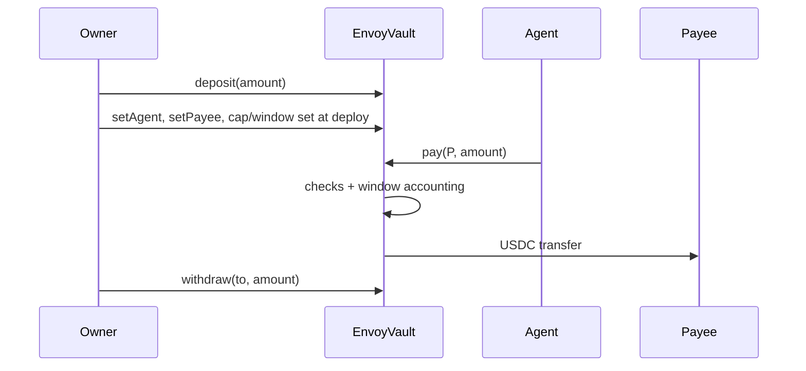

# EnvoyVault Design Doc

## Metadata
- Status: Approved by owner, with revisions R1-R5 below
- Target chain: Arc Testnet (chain ID 5042002), USDC ERC-20 at `0x3600000000000000000000000000000000000000` (6 decimals)
- Language / toolchain: Solidity ^0.8.28, Foundry, OpenZeppelin Contracts
- Reviews: [ ] Design  [ ] Security

## Action Items (living)
- R1 `remainingInWindow()` returns 0 when spent >= cap (no underflow). The shared check returns `CapExceeded` in that case, and `tryPay` logs it instead of reverting. Test: pay 3, owner lowers cap to 2, `pay` reverts `CapExceeded`, `tryPay` emits `PaymentRejected(CapExceeded)` and returns false, `remainingInWindow()` is 0.
- R2 Accounting invariant is vault balance >= deposits - payments - withdrawals (not equal), because anyone can send USDC directly to the vault.
- R3 `setAgent` rejects zero address, the owner, and the vault's own address.
- R4 `setWindowDuration` deliberately resets the window (`windowStart = 0`, `spent = 0`); covered by a test and documented in the README.
- R5 `PaymentRejected.reason` is a fixed enum with stable numbering: 0 Paused, 1 PayeeNotAllowed, 2 ZeroAmount, 3 CapExceeded, 4 InsufficientBalance. Documented in the README.
- Stretch goals: batch `setPayees`, fuzz and invariant tests, Slither (skipped with a README note if it cannot run).

## Goals / Non-Goals
Goals
- Owner custodies USDC in a vault and lets one agent address spend it under a hard cap per time window, only to allowlisted payees.
- Owner can pause, revoke the agent, and withdraw at any time.
- Every successful payment and every rejected attempt by the agent is recorded in events.

Non-Goals
- No multi-agent, per-payee caps, or multiple tokens (USDC only).
- No upgradeability, no fee logic, no signatures or meta-transactions.
- No recovery of other ERC-20s or native coin (see Tradeoffs).

## Requirements
Functional
- F1 `pay(payee, amount)`: agent only; reverts if paused, payee not allowlisted, amount is zero, amount exceeds the remaining cap in the current window, or vault balance is too low.
- F2 `tryPay(payee, amount)`: agent only; same checks, but on a policy failure it emits `PaymentRejected(reason)` and returns `false` without moving funds.
- F3 Window: fixed length, starts at the first payment after a reset, spent amount returns to zero once the duration has elapsed.
- F4 Owner: deposit, withdraw (any amount, any time, even paused), set/revoke agent, set cap, set window length, add/remove payees, pause/unpause, two-step ownership transfer.

Security (testable assertions)
- S1 Only the registered agent can move funds out via `pay`/`tryPay`; funds only ever go to an allowlisted payee or to the owner-chosen withdraw target.
- S2 Within any one window, total paid is at most the cap.
- S3 Withdraw is never blocked by pause or by a revoked agent.
- S4 A revoked or replaced agent cannot pay.
- S5 No function can renounce ownership to zero.

## Terminology and Actors
| Term | Meaning |
| --- | --- |
| Window | Fixed period of `windowDuration` seconds, started by the first payment after a reset |
| Cap | Max USDC (6 decimals) that may be paid per window |
| Payee | Allowlisted recipient address |

| Actor | Trust | Powers |
| --- | --- | --- |
| Owner (EOA or multisig) | Trusted | Everything below owner-only |
| Agent (bot or EOA) | Semi-trusted, may be compromised | `pay`, `tryPay` within policy |
| Payee | Untrusted | Receives USDC |
| Anyone else | Untrusted | Read only; direct USDC transfers into the vault are possible |

## Language / Runtime
Solidity ^0.8.28 (checked arithmetic), match the project's EVM target. OpenZeppelin `Ownable2Step`, `ReentrancyGuard`, `SafeERC20`. `renounceOwnership` is overridden to revert.

## Transaction and Execution Model
Each call is atomic. The only external call is the USDC `transfer`/`transferFrom`. All state (window start, spent) is updated before the transfer (checks, effects, interactions), and the money-moving functions are `nonReentrant`.

## Chain Standards and Interfaces
- ERC-20 interface to USDC. On Arc, USDC is also the native gas coin; the vault only ever uses the 6-decimal ERC-20 view and never holds or accepts native value (no `receive`/payable).
- USDC can blocklist addresses: a blocklisted payee makes the transfer revert in both `pay` and `tryPay`.

## Architecture Overview

Flow of funds
| Step | Who moves what | Invariant |
| --- | --- | --- |
| deposit | Owner -> vault | vault balance rises by exactly `amount` |
| pay | Vault -> payee | payee is allowlisted; `spent <= cap` for the window |
| withdraw | Vault -> owner-chosen address | amount <= balance; never blocked by pause |
Resting state: the vault holds the owner's unspent USDC and nothing else is owed to anyone.

## Contract Design
Roles
| Role | Holder | Permissions |
| --- | --- | --- |
| Owner | One address, `Ownable2Step` | all admin functions |
| Agent | One address (zero = none) | `pay`, `tryPay` |

Storage
- `IERC20 immutable usdc`
- `address agent`
- `uint256 cap`, `uint256 windowDuration`
- `uint256 windowStart` (0 = no active window), `uint256 spent`
- `mapping(address => bool) isPayee`
- `bool` paused (OZ `Pausable`)

Modifiers: `onlyOwner`, `onlyAgent` (reverts `NotAgent`), `nonReentrant`.

Write functions
| Function | Caller | Effect | Events | Reverts |
| --- | --- | --- | --- | --- |
| `constructor(usdc, owner, windowDuration, cap)` | deployer | sets config | none | zero usdc/owner, window 0 or > 365 days, cap 0 |
| `deposit(amount)` | owner | pulls USDC from owner | `Deposited` | amount 0 |
| `withdraw(to, amount)` | owner | sends USDC | `Withdrawn` | `to` zero, amount 0, amount > balance |
| `withdrawAll(to)` | owner | sends full balance | `Withdrawn` | `to` zero, balance 0 |
| `setAgent(agent)` | owner | sets agent, resets window | `AgentSet` | zero, owner, or vault address |
| `revokeAgent()` | owner | clears agent, resets window | `AgentRevoked` | no agent set |
| `setPayee(payee, allowed)` / `setPayees(payees, allowed)` | owner | edits allowlist | `PayeeUpdated` | zero or vault address; batch bounded to 100 |
| `setCap(cap)` | owner | updates cap, keeps current spent | `CapUpdated` | cap 0 |
| `setWindowDuration(d)` | owner | updates length, resets window | `WindowDurationUpdated` | 0 or > 365 days |
| `pause()` / `unpause()` | owner | toggles pause | `Paused` / `Unpaused` | OZ standard |
| `pay(payee, amount)` | agent | policy check, then transfer | `PaymentExecuted` | `NotAgent`, `EnforcedPause`, `PayeeNotAllowed`, `ZeroAmount`, `CapExceeded`, `InsufficientBalance` |
| `tryPay(payee, amount)` | agent | same checks; returns bool | `PaymentExecuted` or `PaymentRejected(reason)` | only `NotAgent` and token transfer failure |
| `transferOwnership` / `acceptOwnership` | owner / pending | two-step handoff | OZ events | OZ standard |

Pseudocode (shared by both payment paths)
```
reason = check(payee, amount)        // Paused, PayeeNotAllowed, ZeroAmount, CapExceeded, InsufficientBalance
if reason != None: pay -> revert error ; tryPay -> emit PaymentRejected; return false
if windowStart == 0 or now >= windowStart + windowDuration: windowStart = now; spent = 0
spent += amount                      // effects first
usdc.safeTransfer(payee, amount)     // interaction last
emit PaymentExecuted
```
`check` evaluates cap against the window as it would be after an automatic reset, without writing state, so rejected attempts never change accounting.

Reads: `agent`, `cap`, `windowDuration`, `windowStart`, `spent`, `isPayee`, `remainingInWindow()` (cap minus spent, or full cap if the window has expired), `windowEnd()`, `balance()`.

Events: `Deposited(from, amount)`, `Withdrawn(to, amount)`, `AgentSet(agent)`, `AgentRevoked(agent)`, `PayeeUpdated(payee, allowed)` (payee indexed), `CapUpdated(old, new)`, `WindowDurationUpdated(old, new)`, `PaymentExecuted(agent, payee indexed, amount, spentInWindow, windowEnd)`, `PaymentRejected(agent, payee indexed, amount, reason)`.

Rejected-attempt events: a revert discards its own events, so only `tryPay` can log a rejection. A caller that is not the agent always reverts (never logged), so strangers cannot spam events.

## Deployment and Initialization
Constructor args: USDC address, owner, window seconds, cap (6-decimal units, e.g. 5 USDC per hour = `5000000`, `3600`). Runbook after deploy: owner approves USDC to the vault, calls `deposit`, `setAgent`, `setPayees`. The deployer key is not given any role unless it is also the chosen owner.

## Upgradeability
None (immutable). Migration story: deploy a new vault, owner withdraws from the old one, points the agent at the new address.

## Key Management
Owner should be a multisig in production; the agent key is hot and only ever risks one cap per window. No off-chain signatures, so no replay surface.

## Security Considerations
| Vulnerability | Applicable? | Mitigation |
| --- | --- | --- |
| Reentrancy | Yes (token calls) | CEI plus `nonReentrant` on deposit, withdraw, pay, tryPay |
| Access control | Yes | `onlyOwner` / `onlyAgent` on every state-changing function |
| Overflow / underflow | Checked 0.8 | No `unchecked` blocks |
| Unchecked external call | Yes | `SafeERC20` |
| Fee-on-transfer / rebasing | No (USDC) | USDC only, amount accounted as requested |
| Signature replay | N/A | No signatures |
| Front-running / MEV | Low | Owner withdraw can race an agent payment; both orders are safe |
| Oracle / flash loan | N/A | No price inputs |
| Denial of service | Low | No unbounded loops; batch payee update capped |
| Delegatecall / proxy | N/A | No delegatecall, immutable |
| Timestamp dependence | Yes | Only `block.timestamp` for window, tolerance of seconds is fine |
| Approval persistence | Low | Owner approves vault; deposit pulls exact amount |
| Centralization | Yes | Owner is fully trusted; mitigated by two-step transfer and multisig advice |
| Window edge | Yes | A burst of cap at end of one window and cap at start of the next can pay up to 2x cap in a short span. Accepted for fixed windows. |
| Event spam | Yes | Rejections logged only for the registered agent |
| USDC blocklist | Yes | Transfer reverts; no funds lost, owner can remove the payee |

## Trust Model and Threat Analysis
| Actor | Worst case if compromised | Mitigation | Detection |
| --- | --- | --- | --- |
| Agent key | Drains up to one cap per window (up to 2x at a boundary) to allowlisted payees only | Small cap, tight allowlist, owner pause/revoke | `PaymentExecuted` and `PaymentRejected` alerts |
| Owner key | Full drain, change anything | Multisig, two-step ownership | Admin events |
| Payee | Nothing beyond what was paid | Allowlist | n/a |

## Emergency Response
`pause()` stops all agent payments instantly; `revokeAgent()` removes the agent; `withdraw`/`withdrawAll` always work. Playbook: pause, revoke, withdraw, then redeploy if needed.

## Failure Scenarios
- USDC transfer reverts (blocklisted payee, USDC paused): the whole call reverts, window accounting is unchanged.
- Vault underfunded: `pay` reverts `InsufficientBalance`; `tryPay` logs it.
- Window expires with no payments: next payment starts a fresh window.

## Priorities and Tradeoffs
| Decision | Tradeoff | Rationale |
| --- | --- | --- |
| `pay` reverts plus separate `tryPay` | Two entry points | Clear errors for callers, loggable rejections for monitoring |
| Fixed lazy window | Boundary burst up to 2x cap | Simple, cheap, predictable. Rejected: rolling window (gas, complexity), clock-aligned (less intuitive) |
| `Ownable2Step`, no renounce | Slower handoff | Prevents loss of control |
| Immutable | No in-place fixes | Smaller attack surface for a money-holding contract |
| No rescue of stray tokens/native | Mistaken sends stay stuck | USDC sent directly is withdrawable; other assets out of scope |
| Setting the agent or window length resets the window; changing the cap does not | Cap raise takes effect immediately inside the current window | Matches the owner's intent |

## Testing Strategy
Foundry unit tests for: cap boundary (exactly cap passes, cap+1 reverts), cumulative payments, window reset after duration, allowlist add/remove, pause and unpause, revoke and replace agent, withdraw (partial, all, while paused), access control for every function, `tryPay` rejection events and no state change, events on success, two-step ownership, constructor validation. Fuzz: total paid in a window never exceeds the cap. Invariant: vault balance equals deposits minus payments minus withdrawals. Slither static analysis. Command: `forge test`.

## Third-party libraries
OpenZeppelin Contracts (already a dependency in the Arc Studio sandbox; audited): `Ownable2Step`, `ReentrancyGuard`, `Pausable`, `SafeERC20`.

## Monitoring and Alerting
| Event | Threshold | Severity |
| --- | --- | --- |
| `PaymentRejected` | any | Medium (agent misbehaving or misconfigured) |
| `PaymentExecuted` | spent near cap | Low |
| `AgentSet`, `CapUpdated`, `Paused`, owner events | any | High (admin change) |

## Worked Example
Cap 5 USDC, window 1 hour. t=0 agent pays 3 (window starts, spent 3). t=10m agent pays 3: `pay` reverts `CapExceeded`; `tryPay` emits `PaymentRejected(CapExceeded)`. t=70m agent pays 3: window expired, resets, spent 3.
